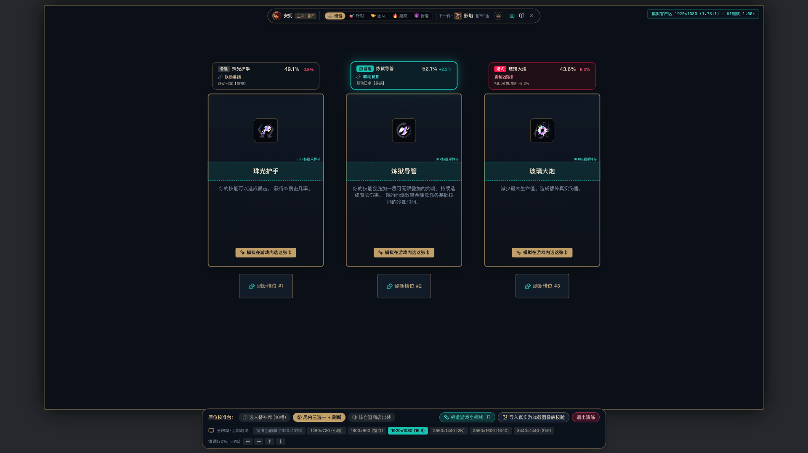
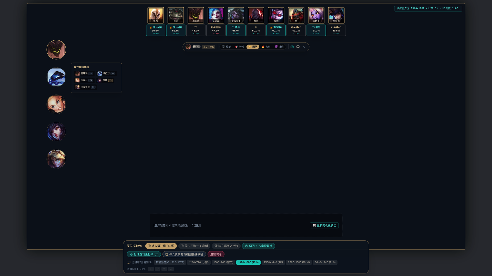
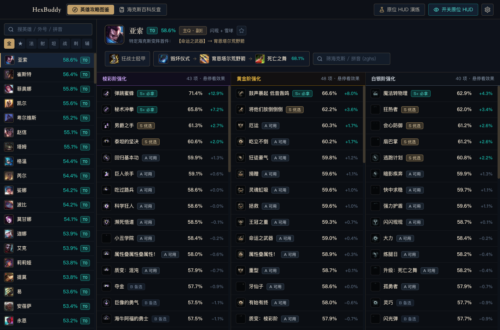

# HexBuddy（海斗军师）

<p>
  <a href="https://github.com/mik-myp/hex-aram-assistant/releases/latest"></a>
  
  
  
</p>

面向《英雄联盟》端游 **海克斯大乱斗（ARAM: Mayhem）** 玩家的 **全透明原位空间 HUD + 静态攻略查阅词典** 桌面助手。

专为**熟悉常规 LOL/大乱斗，但对海克斯大乱斗 230+ 强化符文联动、新赛季装备改版或冷门随机英雄不够熟悉**的玩家打造：主窗口退居后台托盘作纯粹的赛前/赛后攻略速查词典；真正进入选人与对局时，由 **100% 鼠标穿透的原位空间 HUD** 直接贴在替补席头像与局内三选一海克斯卡面上，结合本局敌我阵容、实时经济与你的**五种心情倾向**给出即时推荐。

---

## 📥 下载安装（Windows）

前往 [**GitHub Releases**](https://github.com/mik-myp/hex-aram-assistant/releases/latest) 下载最新版本：

- **安装版（推荐）**：`HexBuddy-Setup-x.y.z.exe`（支持自定义安装路径与桌面快捷方式）
- **免安装便携版**：`HexBuddy-Portable-x.y.z.exe`（单文件双击即用）

> 每个版本的新增功能、体验优化与问题修复详见 [**CHANGELOG.md**](./CHANGELOG.md)；应用内「助手设置 → 版本更新与环境自检」也会以卡片形式展示更新说明。

> **画面模式提示**：为使透明原位 HUD 正常叠加在游戏画面上方，请将英雄联盟画面设置保持默认的 **无边框（Borderless）** 或 **窗口化（Windowed）** 模式（传统独占全屏会屏蔽桌面合成层）。

---

## 🖼️ 界面预览

### 1. 局内三选一原位皇冠贴标 + 防自读窄带标题校准


### 2. 选人阶段 10 槽替补席原位贴标 + 阵容体检


### 3. 主窗口高密度静态攻略查阅词典（英雄三列榜单 & 海克斯反查）


---

## ✨ 核心设计：双形态职责分离

| 形态 | 角色定位 | 核心能力 |
| :--- | :--- | :--- |
| **局内原位空间 HUD**<br>*(游戏途中绝对主角)* | 全屏透明、默认 **100% 鼠标点击穿透**，关闭主窗口后真休眠驻留托盘（待机仅 `~60MB`） | • **选人备战席 10 槽原位贴标**：在客户端顶部 10 个替补席头像正下方逐槽标注胜率差、海斗战神/本命与缺前排/补AP提示，绝不遮挡点击换人<br>• **局内三选一原位皇冠贴标**：在屏幕中央三张海克斯卡正上方/正下方直接标注 `👑首选 / 备选 / 避坑`、协同联动与冲突警告<br>• **骰子刷新跟随 & 手动 `+` 秒补录**：选卡期刷新某张卡后 `1.2s` 内自动重扫窄带标题更新评分；选完自动记槽，顶部同时支持 `+` 拼音快速补录修正<br>• **阵亡泉水动态出装条 + 点击复制搜商店**：存活打架时收起为微胶囊；阵亡回泉水自动展开 **鞋 + 5 件套路线图**（点击任意装备一键复制名称，`Ctrl+V` 秒搜商店） |
| **主窗口攻略图鉴**<br>*(赛前/赛后静态词典)* | 高信息密度、零弹窗干扰的纯查阅工具 | • **170+ 英雄单屏速查**：左侧 `240px` 单行拼音/外号秒搜（支持 `mft` / `石头人`）+ 顶部单行加点/鞋子/核心三件套 + 下方 `棱彩 | 黄金 | 白银` 三列单行胜率榜（悬停查看详情与绑定神装）<br>• **230+ 海克斯百科反查**：按品阶/机制标签/拼音检索任意海克斯，一键反查最适配该卡的 **Top 10 绝配英雄** 与 **避坑陷阱英雄** |

---

## ⚙️ 助手设置中心与效率工具（v0.4.0 新增）

设置不再挤在弹窗里，而是作为主窗口第 3 个视图 **「助手设置」** 独立呈现：左侧 6 大分类导航，所有选项 **即改即存**。

| 分类 | 可调整内容 |
| :--- | :--- |
| **常规与界面** | 开机自启、关闭主窗口时驻留托盘、主界面字号（标准紧凑 / 舒适护眼 / 大字清晰）、配置备份导入导出（API Key 自动脱敏）、恢复出厂默认 |
| **HUD 外观** | 整体缩放 `80% ~ 130%`、背景通透度（实心暗金 / 毛玻璃 / 极简通透）、信息密度（新手详尽 / 老手极简）、选人与选卡分阶段开关，右侧 **1:1 实时预览** |
| **快捷键与识别** | 点击后直接按键录制组合键，自动检测与微信 / QQ / 显卡驱动等常见热键的冲突；OCR 自动识别与刷新跟随开关 |
| **攻略与数据** | 默认决策倾向、数据分段口径、复制装备名后 10 秒自动还原剪贴板、本地缓存占用查看与清理 |
| **AI 锦囊** | AI 总开关、接口连通延迟一键测速、「实用干货 / 毒舌整活 / 新手保姆」三档解说语气 |
| **版本与自检** | 在线检查更新与结构化更新说明、4 项环境自检（画面模式 / 管理员权限 / 数据源 / OCR）、访问数据源仓库 |

另外还有：

- **`Ctrl + K` 全局拼音速查**：中文或拼音首字母跨库秒搜 170+ 英雄、230+ 海克斯、装备与设置项，回车直达。
- **首次启动引导条**：30 秒内提示无边框画面模式与 WeGame 管理员权限要求，并可免开游戏一键体验三选一演练。
- **对局中免打扰**：进入对局后自动推迟更新提示等弹窗，不打断操作。
- **护眼排印**：高清中文 / 数字字体栈 + Windows ClearType 亚像素渲染，次级文字对比度达 WCAG AAA（`≥ 7.4:1`），局内 HUD 文字附加抗眩光描边。主界面字号缩放与 HUD 坐标完全解耦，调大字号不会影响原位贴标对齐。

---

## 🎭 五种局内决策倾向（同一英雄，不同爽法）

大乱斗并非每局都想按固定套路出装。原位 HUD 顶部支持一键切换 **5 种实时决策倾向**，三选一海克斯评分与 6 件套出装路线会随敌我 10 人实时 KDA/装备同步重算：

- `⚖️ 稳健`：综合大数据平滑胜率与基础阵容克制，求稳上分。
- `🎯 针对`：扫描敌方 **高击杀人头大爹**（如 `11杀劫` / `心之钢蒙多`）、多前排与强回血，高优置顶反甲/重伤/百分比穿透/防秒装。
- `🤝 团队`：检测我方缺前排或全队偏单系伤害（全 AP / 全 AD），自动为石头人/大树/卡牌等双修英雄切出前排承伤或混伤补位方案。
- `🔥 独爽`：**只顾自己爽！** 压低纯防守卡权重，拉满珠光护手、玻璃大炮、核弹暴击与极限爆发神装。
- `😈 折磨`：优先炼狱导管、冰寒、残疫、冰杖、心之钢、无终恨意等无限灼烧减速或不死回血恶心流。

此外内置 **硬机制冲突拦截器**（例如已拿封印大招的【回归基本功】时，后续刷新到大招触发类海克斯/【残疫】会自动标红避坑）。

---

## 🖥️ 窗口大小、多分辨率与带鱼屏适配

1. **剥离标题栏与隐形边框（Windows 客户区精准追踪）**
   - 后台单进程常驻调用 `SetProcessDpiAwareness(2)` + `FindWindowW("RiotWindowClass" / "RCLIENT")` + `GetClientRect` + `ClientToScreen`，彻底剥离窗口化模式下 Windows 顶部 `~32px` 标题栏与 `8px` DWM 隐形阴影边框。
2. **100% ~ 225% 系统 DPI 缩放与多屏混合缩放兼容**
   - 物理像素通过 Electron `screen.screenToDipRect` 实时换算为对应显示器的逻辑 DIP 坐标，笔记本 `150%` 缩放外接 `100%` 显示器同样 `1:1` 对齐。
   - 内置无边框全屏 `1px` 底边防闪烁保护（避免触发 Windows DWM DirectFlip 黑屏闪屏），并支持 **`Alt + Tab` 切出游戏自动隐藏 HUD、切回自动恢复**。
3. **全比例自适应（`16:9` / `16:10` / `21:9` 超宽带鱼屏 / `4K`）**
   - 客户端备战席严格按 `16:9` 左对齐 10 槽网格缩放，10 槽全满亦零重叠；
   - 局内三选一海克斯严格按**游戏客户区高度 `H` 围绕中心 `W/2` 定位**（`cx = W/2 + (i - 1) × 0.3417 × H`），在 `3440×1440 (21:9)` 带鱼屏与 `2560×1600 (16:10)` 游戏本上均精准锁死卡面；
   - **零自读窄带标题 OCR**：仅裁剪 `0.372H ~ 0.448H` 标题带（`720P` 小窗自动超分放大），与 HUD 自身贴标区域物理隔离，刷新重扫绝不自读干扰。
4. **内置多分辨率与真实截图叠底校准台（macOS / 离线可验证）**
   - 点击右上角 **原位 HUD 演练**，即可在底部校准台一键切换 `1280×720`、`1600×900`、`1920×1080`、`2560×1440 (2K)`、`2560×1600 (16:10)`、`3440×1440 (21:9)` 画布、开启 `1:1` 标准坐标框线、测试 10 槽满席压力，或直接 **导入任意真实游戏截图叠底 + 跑真实 OCR** 直观验证对齐效果，并支持 `±8%` X/Y 微调补偿。

---

## ⌨️ 默认全局快捷键

| 快捷键 | 功能说明 |
| :--- | :--- |
| `Alt + H`（macOS: `Option + H`） | 显示 / 隐藏局内原位空间 HUD（可在设置中自定义） |
| `Alt + S`（macOS: `Option + S`） | 手动触发一次当前屏幕三选一海克斯 OCR 识别（可在设置中自定义） |
| `Alt + M`（macOS: `Option + M`） | 局内循环切换 5 种决策倾向（稳健 / 针对 / 团队 / 独爽 / 折磨） |
| `Ctrl + K`（macOS: `Cmd + K`，主窗口内） | 全局拼音速查：英雄、海克斯、装备与设置项一键直达 |

> 所有全局快捷键均可在主窗口 **「助手设置 → 快捷键与识别」** 中点击后直接按键录制，并自动检测冲突。

---

## 🛡️ 100% 纯只读安全声明

- **选人阶段（LCU API）**：仅执行本地 `GET /lol-champ-select/v1/session` 与只读 WebSocket 事件订阅。**零 `POST / PUT / PATCH`**，绝不提供自动秒抢、自动换人、自动改天赋或自动接受对局功能。
- **对局阶段（Live Client Data API）**：仅读取拳头官方开放的本地只读接口 `GET https://127.0.0.1:2999/liveclientdata/allgamedata` 获取公开阵容、等级、金币与出装。
- **视觉识别**：仅在到达 `3 / 7 / 11 / 15` 级选卡窗口期对屏幕标题窄带执行本地离线 Tesseract 中文 OCR（存活战斗期间 **0 截屏、0 OCR 开销**）。
- **绝不读写游戏进程内存、绝不注入任何 DLL 或修改任何游戏文件。**

---

## 🛠️ 本地开发与构建

```bash
# 1. 安装依赖（Node.js 22+ & pnpm）
pnpm install

# 2. 拉取最新国服海克斯大乱斗统计数据、加点鞋子与装备详情生成离线种子包
pnpm fetch-seed

# 3. 启动桌面热更新开发环境
pnpm dev

# 4. 一键质量门禁：架构边界 / 文件行数检查 + TypeScript 类型检查 + Vitest 单元测试
pnpm check

# 5. 构建生产产物 / 打包 Windows 安装包与便携版
pnpm build
pnpm dist:win
```

在 macOS 上执行 `pnpm dist:mac` 可单独生成 `.dmg`。Apple Silicon 上的产物为 `release/HexBuddy-<版本>-mac-arm64.dmg`。打开磁盘映像后将 `HexBuddy.app` 拖到「应用程序」即可安装。此流程使用临时签名（ad hoc），适合本机测试。公开分发时需另配 Developer ID 签名和公证。

macOS 可使用攻略图鉴和 HUD 演练。游戏窗口边界追踪及切出游戏时自动隐藏 HUD 依赖 Win32，macOS 版没有这些功能。

**技术栈**：Electron + React 19 + TypeScript + Tailwind CSS v4 + [shadcn/ui](https://ui.shadcn.com)（基于 [Base UI](https://base-ui.com) 原语，映射为海克斯暗金主题 Token）。

> **参与贡献**：提交代码前请阅读 [**CONTRIBUTING.md**](./CONTRIBUTING.md)，其中约定了主进程 / 预加载 / 渲染层的架构边界、组件封装与单文件行数上限、Conventional Commits 提交规范及版本发布流程。`pnpm check:arch` 会自动拦截越层引用与超长文件。

> **CI/CD 说明**：仓库内置 [`.github/workflows/build-windows.yml`](.github/workflows/build-windows.yml)，仅在推送 `v*` 标签（如 `git tag v0.4.0 && git push origin v0.4.0`）时自动在 `windows-latest` 构建 `Setup` 与 `Portable` 双版本 `.exe` 并发布至 GitHub Releases，Release 正文自动取自 `CHANGELOG.md` 对应版本段落；日常推送 `main` 分支不会触发打包。

---

## 📜 数据来源与开源协议

- **代码开源协议**：本项目源代码基于 **MIT License** 开源。
- **统计数据署名声明**：国服海克斯大乱斗对局胜率与出装统计数据源自 [czgreat/aramhex-data](https://github.com/czgreat/aramhex-data)，遵循 [**CC BY-NC 4.0（署名-非商业性使用 4.0 国际）**](https://creativecommons.org/licenses/by-nc/4.0/deed.zh-hans) 协议（客户端内置离线快照并支持启动静默增量热更与分段口径切换）。本项目完全免费开源，严禁用于任何商业售卖或收费引流用途。
- **静态图鉴资源**：英雄、装备、海克斯中文描述及图标源自腾讯官方公开图鉴接口与 CommunityDragon，游戏资产版权归 Riot Games 所有。
